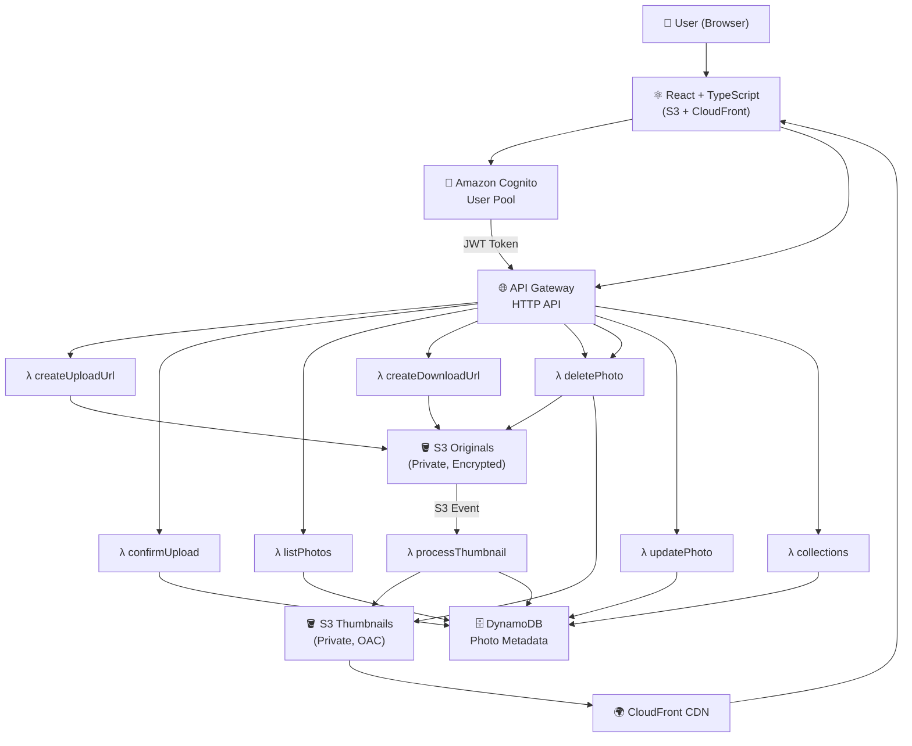

# CloudSnap — Secure Cloud Photo Gallery

<p align="center">
  
</p>

<p align="center">
  <strong>A production-ready, secure cloud photo gallery built on AWS</strong><br/>
  React · TypeScript · AWS Lambda · DynamoDB · S3 · CloudFront · Cognito
</p>

<p align="center">
  
  
  
  
</p>

---

## Overview

CloudSnap is a full-stack, serverless cloud photo gallery application that allows authenticated users to **upload, view, organize, search, sort, download, and delete** photos — all secured with AWS-native services.

It is designed as a portfolio-grade project demonstrating:

- ☁️ Cloud-native AWS architecture
- 🔐 Cognito authentication with JWT-authorized API
- 📦 Direct-to-S3 uploads via pre-signed URLs
- 🖼️ Automatic thumbnail generation with Sharp
- 🚀 CloudFront CDN delivery
- 🗄️ DynamoDB single-table design
- 🏗️ Infrastructure as Code with AWS SAM
- ⚡ Serverless Lambda backend in TypeScript
- 🎨 Premium React + Tailwind UI with dark mode

---

## Architecture



### Upload Flow

```
Browser → Request presigned URL → API Gateway → Lambda
       → S3 PUT (direct, no backend proxy)
       → S3 Event → processThumbnail Lambda
       → Sharp resize → Thumbnails S3 bucket
       → DynamoDB status: READY
       → CloudFront serves thumbnail
```

---

## Features

| Feature | Status |
|---|---|
| User registration & login (Cognito) | ✅ |
| Email verification | ✅ |
| Forgot / reset password | ✅ |
| Protected routes | ✅ |
| Direct S3 upload (pre-signed URL) | ✅ |
| Multi-file upload with progress | ✅ |
| Automatic thumbnail generation (Sharp) | ✅ |
| CloudFront CDN delivery | ✅ |
| Photo grid (grid + compact views) | ✅ |
| Photo detail modal | ✅ |
| Search by filename | ✅ |
| Sort (newest, oldest, name, size) | ✅ |
| Filter by type, date, favorite | ✅ |
| Favorites | ✅ |
| Collections / Albums | ✅ |
| Authorized download (pre-signed GET) | ✅ |
| Secure deletion (originals + thumbnails) | ✅ |
| Dashboard with stats | ✅ |
| Responsive design + mobile nav | ✅ |
| Dark mode | ✅ |
| Least-privilege IAM | ✅ |
| Infrastructure as Code (SAM) | ✅ |
| Unit tests (Vitest) | ✅ |
| Environment documentation | ✅ |

---

## Tech Stack

**Frontend**
- React 18 + TypeScript (strict)
- Vite
- Tailwind CSS v3
- React Router v7
- TanStack Query v5
- Axios
- AWS Amplify Auth v6 (modular)
- React Hook Form + Zod
- Lucide React icons
- React Dropzone
- React Hot Toast

**Backend**
- AWS Lambda (Node.js 20, TypeScript)
- AWS SDK v3 (DynamoDB, S3)
- Sharp (image processing)
- Zod (request validation)
- UUID

**Infrastructure**
- AWS SAM + CloudFormation
- Amazon Cognito User Pools
- Amazon S3 (originals + thumbnails)
- Amazon DynamoDB (single-table)
- Amazon API Gateway HTTP API
- Amazon CloudFront + OAC
- AWS IAM (least privilege)
- Amazon CloudWatch (structured logs)

---

## Repository Structure

```
cloudsnap/
├── frontend/               # React + TypeScript + Vite
│   ├── src/
│   │   ├── components/     # UI primitives & layout
│   │   ├── pages/          # Route pages
│   │   ├── hooks/          # Custom React hooks
│   │   ├── services/       # API service layer
│   │   ├── lib/            # Amplify & API client config
│   │   ├── types/          # TypeScript types
│   │   └── features/       # Feature modules
│   ├── tests/
│   └── .env.example
│
├── backend/                # Lambda handlers (TypeScript)
│   ├── src/
│   │   ├── handlers/       # Lambda function handlers
│   │   ├── repositories/   # DynamoDB data layer
│   │   ├── validators/     # Zod schemas
│   │   ├── utils/          # Shared utilities
│   │   └── types/          # Shared types
│   └── tests/
│
├── infrastructure/         # AWS SAM IaC
│   ├── template.yaml       # SAM/CloudFormation template
│   ├── samconfig.toml.example
│   └── policies/           # IAM policy documents
│
└── docs/                   # Documentation
    ├── architecture.md
    ├── api.md
    ├── security.md
    ├── deployment.md
    ├── troubleshooting.md
    └── cost-estimation.md
```

---

## Prerequisites

| Tool | Minimum Version | Install |
|---|---|---|
| Node.js | 20.x | [nodejs.org](https://nodejs.org) |
| npm | 10.x | Bundled with Node |
| AWS CLI | 2.x | [docs.aws.amazon.com/cli](https://docs.aws.amazon.com/cli/latest/userguide/install-cliv2.html) |
| AWS SAM CLI | 1.100+ | [docs.aws.amazon.com/serverless-application-model](https://docs.aws.amazon.com/serverless-application-model/latest/developerguide/install-sam-cli.html) |
| Git | 2.x | [git-scm.com](https://git-scm.com) |

---

## Quick Start (Local Development)

### 1. Clone the repository

```bash
git clone https://github.com/Lakshayakanna123/cloudsnapp.git
cd cloudsnapp
```

### 2. Install frontend dependencies

```bash
cd frontend
npm install
```

### 3. Configure environment

```bash
cp .env.example .env
# Edit .env with your Cognito and API values
```

### 4. Start the dev server

```bash
npm run dev
# → http://localhost:3000
```

> ⚠️ Without AWS resources deployed, authentication and API features will not function. See [deployment guide](docs/deployment.md).

---

## Environment Configuration

### Frontend (`frontend/.env`)

```env
VITE_COGNITO_USER_POOL_ID=us-east-1_XXXXXXXXX
VITE_COGNITO_CLIENT_ID=xxxxxxxxxxxxxxxxxxxxxxxxxx
VITE_COGNITO_REGION=us-east-1
VITE_API_BASE_URL=https://xxxxxxxxxx.execute-api.us-east-1.amazonaws.com
VITE_CLOUDFRONT_DOMAIN=xxxxxxxxxxxx.cloudfront.net
```

> ⚠️ **Never** add `AWS_SECRET_ACCESS_KEY` or any AWS credentials to `.env` or frontend code.

### Backend (Lambda environment variables — set via SAM)

```
AWS_REGION=us-east-1
ORIGINALS_BUCKET=cloudsnap-originals-{env}
THUMBS_BUCKET=cloudsnap-thumbs-{env}
PHOTOS_TABLE=CloudSnapPhotos
COLLECTIONS_TABLE=CloudSnapCollections
CLOUDFRONT_DOMAIN=xxxxxxxxxxxx.cloudfront.net
MAX_FILE_SIZE_BYTES=52428800
```

---

## AWS Deployment

### Step 1: Configure AWS credentials

```bash
aws configure
# Enter: Access Key ID, Secret Access Key, Region, Output format
```

### Step 2: Install SAM CLI and build

```bash
cd infrastructure
sam build
```

### Step 3: Deploy (guided first time)

```bash
sam deploy --guided
# Follow prompts, save configuration to samconfig.toml
```

### Step 4: Capture outputs

```bash
sam list stack-outputs --stack-name cloudsnap-dev
```

Use the outputs to fill in `frontend/.env`.

### Step 5: Build and deploy frontend

```bash
cd frontend
npm run build
aws s3 sync dist/ s3://{FRONTEND_BUCKET} --delete
aws cloudfront create-invalidation --distribution-id {DIST_ID} --paths "/*"
```

Full deployment details: [docs/deployment.md](docs/deployment.md)

---

## Security Highlights

- 🔐 Cognito JWT authorization on all API endpoints
- 🚫 User identity always derived from verified JWT — never from request body
- 🔑 Short-lived pre-signed URLs (5 min) for upload/download
- 🪣 All S3 buckets private — Block Public Access enforced
- 🌍 CloudFront Origin Access Control (OAC) for thumbnail delivery
- 🛡️ Least-privilege IAM per Lambda function
- 🔒 Encryption at rest (S3 SSE, DynamoDB default)
- 🔍 MIME type validation (server-side)
- 📏 File size enforcement
- 🚧 No stack traces exposed to clients

See [docs/security.md](docs/security.md) for the full security checklist.

---

## Running Tests

```bash
# Frontend tests
cd frontend && npm test

# Backend tests
cd backend && npm test

# Backend with coverage
cd backend && npm run test -- --coverage
```

---

## Cost Considerations

For moderate personal use this project typically falls within AWS Free Tier limits:

| Service | Free Tier |
|---|---|
| Lambda | 1M requests/month |
| DynamoDB | 25 GB storage |
| S3 | 5 GB storage |
| CloudFront | 1 TB transfer/month |
| Cognito | 50,000 MAUs |
| API Gateway | 1M HTTP API calls/month |

See [docs/cost-estimation.md](docs/cost-estimation.md) for detailed analysis.

---

## Troubleshooting

See [docs/troubleshooting.md](docs/troubleshooting.md) for solutions to common issues:
- Cognito auth errors
- CORS failures
- CloudFront 403s
- Sharp compatibility issues
- Pre-signed URL expiry
- DynamoDB validation errors

---

## License

MIT © 2024 CloudSnap Contributors
